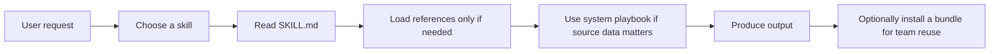
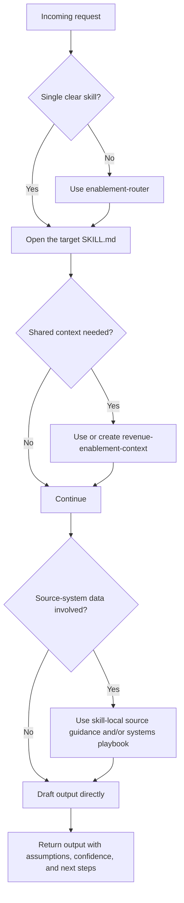

# Enablement Skills

`enablement-skills` is an open-source skill pack for revenue enablement work with agent tools such as Claude Code and Codex.

This repo packages reusable skills, system playbooks, install bundles, examples, and validation scripts for recurring B2B SaaS enablement workflows.

## At A Glance

- `37` skills in [`skills/`](skills/)
- `7` system playbooks in [`systems/`](systems/) plus a registry in [`systems/REGISTRY.md`](systems/REGISTRY.md)
- `7` install bundles in [`plugins/`](plugins/)
- `8` example workflows in [`examples/`](examples/)
- repo-level validation and skill scaffolding in [`scripts/`](scripts/)

## What To Expect In This Package

- A portable repo of focused enablement skills
- A packaging layer for installing those skills through external tooling
- A set of workflow playbooks for turning source-system data into agent-ready inputs
- A starting point that teams can inspect, fork, vendor, and adapt

## Why It Exists

Generic agents can be useful for one-off drafting, analysis, and synthesis. They are usually less reliable for repeated enablement work because they often lack:

- stable workflow boundaries between adjacent tasks
- reusable shared context
- practical guidance for using real CRM, conversation, content, and workspace data
- packaging that makes the same operating model available across a team

This repo exists to add that missing layer.

## What's Included

| Layer | What it does | Canonical location |
| --- | --- | --- |
| Skills | Defines task behavior for specific enablement jobs | [`skills/`](skills/) |
| Systems | Explains how to prepare better inputs from common operating systems | [`systems/`](systems/) |
| Plugins | Groups skills into install bundles | [`plugins/`](plugins/) |
| Examples | Shows representative prompts, inputs, and output shapes | [`examples/`](examples/) |
| Scripts | Validates and scaffolds the repo | [`scripts/`](scripts/) |

Representative skills include:

- foundational: `revenue-enablement-context`, `enablement-router`, `quarterly-enablement-planner`
- messaging: `value-prop-and-positioning`, `talk-track-builder`, `objection-library-builder`, `battlecard-builder`
- coaching: `call-review-coach`, `deal-inspection-coach`, `manager-coaching-cadence`, `forecast-risk-brief`
- programs: `onboarding-program-builder`, `certification-program-builder`
- launch and field readiness: `product-launch-enablement`, `release-notes-to-seller-updates`
- account and leadership prep: `account-brief-builder`, `executive-briefing-builder`, `qbr-ebr-builder`

Representative system playbooks include:

- [`systems/salesforce.md`](systems/salesforce.md)
- [`systems/hubspot.md`](systems/hubspot.md)
- [`systems/gong.md`](systems/gong.md)
- [`systems/highspot.md`](systems/highspot.md)
- [`systems/seismic.md`](systems/seismic.md)
- [`systems/notion.md`](systems/notion.md)
- [`systems/slack.md`](systems/slack.md)

## How It Works



The canonical source of behavior is always [`skills/`](skills/). The other directories support installation, validation, input preparation, examples, and reuse.

## Where To Start

If the right skill is unclear:
- use `enablement-router`

If the team lacks shared operating context:
- start with `revenue-enablement-context`

If the need is clearly role-specific:
- enablement leader: `quarterly-enablement-planner`, `content-governance-system`, `enablement-impact-story`
- frontline manager: `manager-coaching-cadence`, `call-review-coach`, `deal-inspection-coach`, `forecast-risk-brief`
- PMM: `value-prop-and-positioning`, `talk-track-builder`, `objection-library-builder`, `battlecard-builder`
- RevOps: `pipeline-stage-definition-and-exit-criteria`, `enablement-metrics-and-instrumentation`, `forecast-risk-brief`
- account / leadership prep: `account-brief-builder`, `executive-briefing-builder`, `qbr-ebr-builder`

## Installation And Distribution

This repo is packaged for two external distribution paths. The install commands below assume the relevant external tooling is available in the target environment.

### Agent Skills CLI

```bash
npx agent-skills-cli add nthnclrk/enablement-skills
```

In this mode, the external CLI is the installer. This repo is content and packaging, not a CLI product of its own.

### Claude Code Marketplace

```text
/plugin marketplace add nthnclrk/enablement-skills
/plugin install enablement-core@enablement-skills
```

Additional bundles are available under [`plugins/`](plugins/):

- `enablement-core`
- `enablement-messaging`
- `enablement-programs`
- `enablement-measurement`
- `enablement-launches`
- `enablement-crm-pack`
- `enablement-ci-pack`

### Clone, Vendor, Or Fork

Teams that want a reviewed internal baseline can:

- clone the repo directly
- vendor it into a larger workspace
- fork it and use the fork as the install source

Example submodule install:

```bash
git submodule add https://github.com/nthnclrk/enablement-skills.git vendor/enablement-skills
```

## For AI Agents Using This Package

If you are an agent using this repo as an input source, treat it as a skill pack and workflow guide.

### How Agents Should Use It

1. Start with [`skills/`](skills/). Each skill folder is the unit of behavior.
2. Read `SKILL.md` first and only load supporting files when they are actually needed.
3. If the request is ambiguous or multi-part, start with [`enablement-router`](skills/enablement-router/SKILL.md).
4. If the request depends on shared company context, prefer [`revenue-enablement-context`](skills/revenue-enablement-context/SKILL.md) before running downstream skills.
5. Use `references/` progressively. Do not bulk-load every reference file.
6. Treat [`systems/`](systems/) as optional workflow playbooks for input preparation and safe write-back boundaries, not as executable integrations.
7. Use [`examples/`](examples/) as shape guidance for prompts and outputs, not as golden truth.
8. Preserve uncertainty. If source data is stale, sparse, or contradictory, label assumptions and confidence rather than fabricating precision.
9. Keep writeback conservative. These skills are designed to help draft, analyze, and structure work, not to assume automatic writes into source systems.

### Suggested Agent Flow



### Agent Guardrails

- Do not assume every system capability described in a vendor product exists in the user's tenant.
- Do not assume the repo provides API clients, MCP servers, or direct integrations.
- Do not assume every workflow should start with a system playbook.
- Do not assume bundle installation changes how the skill itself behaves; bundles are packaging, not alternate logic.

## Package Structure

```text
.
├─ skills/                          # canonical skill source
├─ systems/                         # source-system playbooks and registry
├─ plugins/                         # install bundles
├─ examples/                        # representative usage examples
├─ scripts/                         # validation, eval scaffolding, scaffolding
├─ templates/                       # skill templates used by the scaffold
├─ .claude-plugin/                  # marketplace manifest
├─ README.md
├─ ARCHITECTURE.md
├─ AGENTS.md
└─ VERSIONS.md
```

See [`ARCHITECTURE.md`](ARCHITECTURE.md) for the fuller repo model.

## Examples

Representative example workflows live in [`examples/`](examples/), including:

- [`examples/revenue-enablement-context/README.md`](examples/revenue-enablement-context/README.md)
- [`examples/enablement-router/README.md`](examples/enablement-router/README.md)
- [`examples/talk-track-builder/README.md`](examples/talk-track-builder/README.md)
- [`examples/manager-coaching-cadence/README.md`](examples/manager-coaching-cadence/README.md)
- [`examples/forecast-risk-brief/README.md`](examples/forecast-risk-brief/README.md)
- [`examples/call-insights-to-objections/README.md`](examples/call-insights-to-objections/README.md)
- [`examples/content-gap-analysis/README.md`](examples/content-gap-analysis/README.md)
- [`examples/product-launch-enablement/README.md`](examples/product-launch-enablement/README.md)

## Validation

Run repo validation before publishing changes:

```bash
bash scripts/validate.sh
```

This checks repo-specific conventions including:

- skill structure
- required metadata
- link validity
- bundle consistency
- scaffold placeholder leakage
- eval artifact presence

For optional ecosystem validation against an external Agent Skills validator:

```bash
bash scripts/validate-official.sh
```

That script uses `skills-ref`, `skills`, or `agent-skills-cli` if one of them is available in the environment.

## Adding Or Updating Skills

New skills should stay compact, procedural, and bounded.

Design rules used in this repo:

- keep `SKILL.md` focused on what to do
- keep deep frameworks in `references/`
- prefer tool-agnostic workflows unless a tool materially improves execution
- include explicit output contracts and quality bars
- make boundaries and adjacent-skill routing visible

Use the scaffold to create a new skill:

```bash
bash scripts/new-skill.sh my-new-skill
```

## Scope And Limits

This package provides representative, practical guidance for common enablement workflows. It is intentionally selective rather than exhaustive.

The systems in this space change quickly, including AI-native workflows inside the tools themselves. Treat the system layer as a starting point for reliable export, analysis, and controlled write-back patterns. Verify advanced, tenant-specific, or newly released capabilities against current vendor documentation and the user's actual workspace setup.

## Use And Responsibility

This package is freely distributed under the [MIT License](LICENSE) and is provided on an `as is` basis.

In practice, that means:

- there is no warranty that a skill, example, system playbook, or output will fit your exact environment or use case
- you are responsible for reviewing outputs, verifying assumptions, and deciding what to publish, automate, or act on
- maintainers and contributors do not assume liability for losses, damages, or business outcomes resulting from use, misuse, or reliance on this package or its outputs

If you use this repo in production, customer-facing work, regulated environments, or revenue-critical decisions, keep a human review step in the loop.

## Legal And Support

- License: [MIT](LICENSE)
- Architecture: [ARCHITECTURE.md](ARCHITECTURE.md)
- Contributing: [CONTRIBUTING.md](CONTRIBUTING.md)
- Security: [SECURITY.md](SECURITY.md)
- Support: [SUPPORT.md](SUPPORT.md)

This project is independent and is not affiliated with or endorsed by Salesforce, HubSpot, Gong, Highspot, Seismic, Notion, Slack, Anthropic, or OpenAI. Product names and trademarks remain the property of their respective owners.
